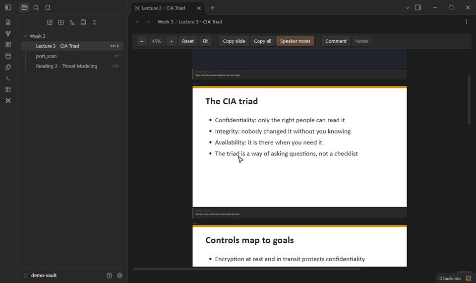

<h1 align="center">Lectern</h1>

<p align="center">
  Read your lecture files inside Obsidian, select and copy the text, and leave margin comments that live in your vault as plain markdown.
</p>

<p align="center">
  <a href="https://github.com/Sqxirts/lectern/releases/latest"></a>
  
  <a href="LICENSE"></a>
</p>

<p align="center">
  
</p>

## What it does

- **Opens Office and code files.** `.pptx`, `.docx`, `.xlsx`, `.xls`, and 130+ code and text formats, with syntax highlighting, zoom and pan.
- **Find in any file.** `Ctrl+F` searches slides, speaker notes, Word documents, every sheet of a workbook, and code.
- **Slide text is real text.** Drag-select and `Ctrl+C` work on slides. Other preview plugins draw slides to a canvas, which is just pixels.
- **Copies a deck out as markdown.** `Copy slide` grabs one slide; `Copy all` exports the whole deck with one heading per slide. Speaker notes show under each slide.
- **Word-style margin comments.** Select text, run **Comment on selection** (or your hotkey for it), write a note. Cards sit in a right-hand margin with a line to the highlight.
- **Highlight without a note.** Select text and run **Highlight selection** (or the toolbar button). The card shows **Add note** if you change your mind.
- **Comments on PDFs too,** inside Obsidian's own PDF viewer. Right-click a selection and pick **Highlight and comment**. Page links, search and thumbnails keep working.
- **A comment index.** **Open the comment index** makes a Base listing every annotated file with its open and resolved counts, busiest first.
- **Export to markdown.** **Export** in the toolbar copies a deck, Word document or workbook as markdown, or saves it as a note next to the file (`Name (export).md`). Re-exporting refreshes that note and never overwrites one you wrote.
- **Your files are never modified.** Comments go to a sidecar note in `File-Notes/`, so they show up in search, backlinks and sync like any other note. In the note, each comment links back to its spot in the file.

## Install

**From a release (recommended).** Download `main.js`, `manifest.json` and `styles.css` from the [latest release](https://github.com/Sqxirts/lectern/releases/latest) into:

```
<your vault>/.obsidian/plugins/lectern/
```

Then fully quit and reopen Obsidian, and enable **Lectern** under *Settings → Community plugins*. A plugin reload is not enough the first time, because Obsidian only registers new file types at startup.

**Set a hotkey.** Lectern ships without one so it can't clash with yours. Go to *Settings → Hotkeys*, search "Lectern: Comment on selection", and bind it. `Ctrl+Alt+M` is the one the author uses, and the one Word uses for a new comment.

Desktop only. Lectern needs Obsidian 1.14 or later on Windows, macOS or Linux.

**From source.**

```bash
git clone https://github.com/Sqxirts/lectern.git
cd lectern
npm install
npm approve-scripts esbuild   # npm blocks postinstall scripts by default
cp .env.example .env.local    # set LECTERN_OUT to <vault>/.obsidian/plugins/lectern
npm run build
```

Without `LECTERN_OUT` the build goes to `./dist`.

## Usage

| To | Do |
|---|---|
| Comment on a selection | The **Comment** toolbar button, or the **Comment on selection** command |
| Highlight with no note | The **Highlight** toolbar button, or the **Highlight selection** command. In a PDF, right-click → **Highlight without a note** |
| Comment on a PDF selection | Right-click → **Highlight and comment**, or the same command |
| Export a file as markdown | **Export** in the toolbar, or the **Copy as Markdown** / **Save as Markdown note** commands. Decks, Word documents and workbooks |
| Copy one slide / the whole deck | **Copy slide** / **Copy all** in the toolbar |
| Zoom / pan | `Ctrl+scroll` or the toolbar; middle-drag to pan |
| Find text in a file | `Ctrl+F` (`Cmd+F` on Mac) while a Lectern tab is focused, or **Find** in the toolbar. `Enter` / `Shift+Enter` step through matches; a spreadsheet switches to the sheet holding the match |
| See comments across the vault | **Open the comment index** command. It creates `Comments.base` in the comment folder |
| Hide a finished comment | **Resolve** on the card. It stays in the sidecar note |
| See or reopen resolved comments | **Show resolved** in the toolbar; in a PDF, right-click the page. Or the **Show or hide resolved comments** command |
| Edit a text or code file | **Edit**, then **Save** in the toolbar |

Settings cover the comment folder, default zoom, speaker notes, showing resolved comments, PDF comments on or off, and per-file-type toggles for when another plugin already handles a format.

A comment card and its sidecar entry look like this:

```markdown
## Slide 2: "The triad is a way of asking questions, not a checklist"

Likely midterm question. Compare with STRIDE in Reading 3.
```

Each comment remembers the exact quote plus the text around it. If the file changes, Lectern finds the quote again; if it can't, the card is flagged **orphaned** instead of disappearing. Details in [docs/comments.md](docs/comments.md).

## What it touches outside your vault

On **Windows only**, slides that contain old Windows vector images (EMF/WMF), which browsers can't display, are converted to PNG through PowerShell and the built-in .NET imaging library. Each image is written to a temporary folder in your system temp directory (`lectern-emf-*`), converted, and the folder is deleted straight away. On macOS and Linux those images show a labelled placeholder instead. Nothing else leaves the vault, and Lectern makes no network requests.

## Known limits

- Slide fidelity is practical, not pixel-perfect. No SmartArt, animations, embedded media or 3D, and fonts are not embedded. That is the trade for selectable text.
- PDF comments need a text layer, so scanned PDFs can't be commented. One comment can't span two pages, and PDF embeds inside notes (`![[x.pdf]]`) aren't covered.
- PDF comments use Obsidian internals that aren't public API (tested on Obsidian 1.14.4). If an update breaks them, the feature switches itself off with a notice and the viewer keeps working. It also stays off while PDF++ is enabled.
- Code files can be commented in read mode only.
- Markdown export keeps headings, paragraphs, lists, tables and bold or italic text. Images, text boxes, footnotes and Word comments are left out.
- Spreadsheets are capped at 5,000 rows and 256 columns per sheet.

## Development

```bash
npm run dev        # rebuild on save
npm test           # vitest
npm run typecheck
npm run lint       # the community directory's eslint rules
```

Run `npm run lint` before every release. It uses [eslint-plugin-obsidianmd](https://github.com/obsidianmd/eslint-plugin), the same rules the community directory's release review applies, so a warning here would turn that review from Passed to Satisfactory.

After the first launch you can pick up a rebuild by toggling the plugin off and on. Test fixtures are generated, not committed: `python fixtures/make_fixtures.py` (needs `python-pptx`, `python-docx`, `openpyxl`).

- [docs/architecture.md](docs/architecture.md): how the code is laid out, the PDF internals, HTML sanitising, dependencies
- [docs/comments.md](docs/comments.md): the sidecar format and how anchors are resolved
- [tools/demo/](tools/demo/): re-records the GIF above

## Licence

[MIT](LICENSE)
